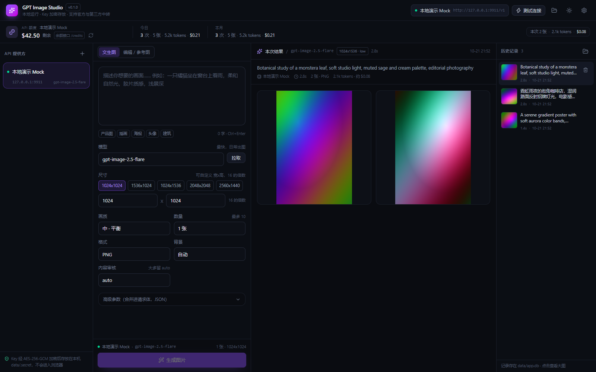
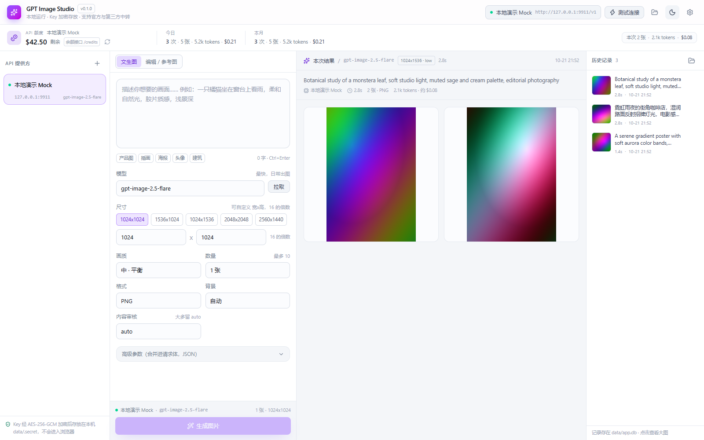

# GPT Image Studio（gpt-image2.5-generator）

本地优先的图片生成工作台：React 前端 + Node BFF，直连 OpenAI 官方接口，也支持任何兼容 Images API 的第三方中转。

- 仓库：https://github.com/BREEY05/gpt-image2.5-generator
- 本地目录：D:\gpt-image2.5-generator
- API Key 只保存在本机（AES-256-GCM 加密），浏览器永远拿不到明文

深色（默认）：

浅色：

---

## 一、怎么启动（最重要的一节）

有两种用法：普通用户直接装 .exe；想改代码或没打包时用源码 + start.bat。

### 方式一：下载安装包（.exe，推荐）

1. 到 GitHub Releases 页面下载 GPT-Image-Studio-<版本>-Setup.exe（当前 0.1.0）
2. 双击安装：**每用户安装**，不需要管理员权限，可以自选安装目录
3. 装完桌面会有「GPT Image Studio」图标，开始菜单里也有；双击即可启动，不需要 Node.js
4. 首次启动会自动在 %APPDATA%\GPT Image Studio\data 建立全新的空数据库
5. 卸载默认**保留**数据；想彻底清空就先卸载，再手动删除上面那个 data 目录

> 安装包没有做代码签名，Windows SmartScreen 可能提示「未知发布者」：点「更多信息」→「仍要运行」即可；这是开源项目自行打包的常见提示。

### 方式二：源码运行（双击 start.bat）

- 第一次运行会自动安装依赖、构建前端（约 1-2 分钟），之后每次只启动服务（2 秒）
- 启动完会自动打开浏览器，地址是 http://127.0.0.1:8787
- 黑色窗口不要关，关掉窗口就等于关掉服务
- 下次再用：再双击一次 start.bat 就行，数据都在 data 目录里，不会丢

如果双击闪退：右键 start.bat → 编辑，或直接右键 → 在终端中运行，看窗口里的报错。常见原因是没装 Node.js，或依赖没装成功。

**想要桌面图标**：双击 create-shortcut.bat，会在桌面创建「GPT Image Studio」快捷方式，以后双击图标即可。

**想要开机自启**：先创建桌面快捷方式，然后 Win+R 输入 shell:startup 回车，把图标拖进打开的文件夹。注意这样开机就会占着 8787 端口。

**命令行方式**（开发或习惯终端）：

    cd /d D:\gpt-image2.5-generator
    pnpm start        # 生产模式，需要已经 pnpm build 过
    pnpm dev          # 开发模式，前端 http://localhost:5173 热更新，接口代理到 8787

**服务已经在跑的时候**再双击 start.bat，它会检测到 8787 已有服务，只打开浏览器，不会重复启动。

**打不开怎么办**：

| 现象 | 处理 |
|---|---|
| 窗口一闪而过 | 说明 node 或依赖有问题，右键 start.bat → 编辑，看清报错；确认 node -v 能输出版本 |
| 提示端口被占用 | 已经有实例在跑，直接访问 http://127.0.0.1:8787；或先结束旧 node 进程 |
| 浏览器打不开页面 | 看窗口日志里「已启动: http://127.0.0.1:8787」；手动复制地址粘贴 |
| 换了电脑 | 装上 Node 20+，把整个目录（含 data）拷过去，双击 start.bat 即可 |

---

## 二、界面与主题

- 右上角太阳/月亮图标：一键切换深色 / 浅色，立即生效并记住选择
- 设置弹窗里可选三档：深色、浅色、跟随系统
- 主题存在浏览器 localStorage，刷新不会闪一下白色

---

## 三、额度与用量

页面顶部有一条常驻额度条（深色/浅色主题下都可见），分三块：

| 区域 | 显示什么 | 数据来源 |
|---|---|---|
| 左侧 | 剩余额度、上限、已用、接口来源 | 依次尝试上游的 /credits、/dashboard/billing/subscription + /dashboard/billing/usage、/usage；sk-admin 开头的 Key 还会试 /organization/costs |
| 中间 | 今日 / 本月的次数、张数、token、预估金额 | 本机 SQLite 统计，不上传任何地方 |
| 右侧 | 上一次生成的张数、token、金额 | 那条生成记录 |

几点说明：

- OpenAI 官方 API Key 本身**没有余额查询接口**，这时额度条会显示「这个服务商没有开放额度查询接口」，并在下方照常显示本地统计，不影响生成
- 中转的兼容度不一样：常见的中转会实现 /credits 或 /usage，能直接读出余额；也有不少只提供 /v1/models 和 /v1/images，那就只能看本地统计
- 金额是**估算**：在设置里填「输入/输出 token 单价」（USD / 百万 token），填 0 表示只统计 token 不折算金额。改单价后历史记录也会按新单价重新计算
- 每次生成后自动刷新；也可以点额度条右侧的刷新图标强制重查（服务端缓存 60 秒，避免把额度接口打爆）
- 统计只落在本机 data/app.db，与 Key 一样不会离开这台机器

## 四、功能

- 多 Provider 管理：官方、中转、自建网关并存，各自独立 Base URL / Key / 默认模型
- Key 加密落盘（AES-256-GCM + 本机随机密钥），接口只返回 sk-...abcd 掩码
- 两级连通性测试：/models 快测（不花钱） + 深度测试（真出一张小图，验证权限/额度/模型名）
- 参数面板：模型、尺寸（预设 + 自定义 WxH）、画质 low/medium/high/xhigh/max/auto、数量 1-10、格式 png/jpeg/webp、背景、压缩质量、内容审核
- 高级参数：任意 JSON 直接合并进请求体（input_fidelity、seed、中转私有参数都从这里透传）
- 文生图 + 图片编辑（参考图 / 遮罩上传）
- 历史记录：SQLite 存提示词与完整参数，图片落盘，大图预览、下载、删除
- 并发队列（默认 2，可调 1-8）、429/502/503/504 自动重试、错误码翻译成中文修复建议
- 深色 / 浅色主题
- 顶部额度条：上游余额（best-effort）+ 今日/本月用量 + 本次生成消耗，每次生成后自动刷新
- token 统计与费用估算：记录输入/输出 token，按设置里的单价折算美元，历史记录同样适用

---

## 五、第一次使用

1. 左侧「+」添加 Provider
2. Base URL：官方填 https://api.openai.com/v1 ；中转填对方给的地址（通常也以 /v1 结尾）
3. 认证方式：默认 Bearer；个别自建网关用 api-key 头
4. API Key 粘贴进去（保存后只显示掩码）
5. 默认模型填你账号实际支持的，例如 gpt-image-2.5-flare / gpt-image-2.5-sunburst / gpt-image-1；不确定就点「拉取」读取 /models
6. 保存后点左侧列表的闪电图标测连通；想更确定就打开编辑弹窗点「深度测试（真出 1 张图）」

### 没有 Key 想先看效果

自带一个本地假服务，不联网、不花钱，返回彩色渐变图：

    # 终端 A
    pnpm mock

    # 终端 B
    pnpm start

添加 Provider：Base URL 填 http://127.0.0.1:9911/v1，Key 随便填 sk-demo，模型填 gpt-image-2.5-flare。

假服务内置错误开关：提示词里包含 MOCK401 / MOCK429 / MOCK500 会返回对应错误，用来验证错误提示。

---

## 六、参数与接口对应

| 界面项 | 请求体字段 | 说明 |
|---|---|---|
| 模型 | model | 以账号/中转实际支持为准，不硬编码 |
| 尺寸 | size | 自定义时两边需为 16 的倍数，宽高比 1:3~3:1，长边不超过 3840 |
| 画质 | quality | gpt-image 系列 low/medium/high，2.5 另有 xhigh/max |
| 数量 | n | 1-10 |
| 格式 | output_format | png / jpeg / webp |
| 背景 | background | transparent 仅对 png/webp 有效 |
| 压缩质量 | output_compression | 仅 jpeg/webp，0-100 |
| 内容审核 | moderation | auto / low |
| 高级参数 | 原样合并 | 覆盖同名字段 |

请求 POST {BaseURL}/images/generations，编辑走 /images/edits（multipart）。gpt-image 系列只返回 b64_json；若中转返回 url，后端会自动下载落盘。

---

## 七、数据与安全

| 路径 | 内容 |
|---|---|
| data/app.db | Provider、生成记录、设置（SQLite） |
| data/images/ | 生成的图片 |
| data/.secret | 加密 API Key 的 32 字节密钥 |

- Key 只在服务进程内解密，接口响应只有掩码
- 服务只监听 127.0.0.1
- **每个用户都是全新状态**：仓库与安装包都不含 data/，首次启动才创建空库；截图里的数据来自本地 Mock 演示
- 发行前可用 pnpm verify:release 扫描安装产物，确认其中没有 data/、.db、.secret、.env 和 sk- 开头的 Key
- 备份/迁移：**先关闭服务**，再把整个 data 目录拷走。服务每 15 秒把 WAL 落回主库，正常关闭时会做完整检查点
- .secret 丢失后，Key 需要重新填写

---

## 八、常见问题

| 现象 | 原因与处理 |
|---|---|
| 401 Incorrect API key | Key 不完整 / 已吊销 / 账号不对 |
| 403 | Key 未授权访问该模型，或组织受限 |
| 404 model not found | 模型名错，或 Base URL 少了 /v1 |
| 400 invalid size / quality | 模型不支持该尺寸或画质档位 |
| 429 | 限流或额度不足；降并发、等一会、换 Key |
| 网络不可达 / 超时 | 本机到该域名不通。需要代理时：PowerShell 里设置 $env:HTTPS_PROXY 和 $env:NODE_USE_ENV_PROXY=1 后再 pnpm start |
| 返回内容不是 JSON | Base URL 填成了网站首页 |
| 出图很慢 | high/xhigh/max + 大尺寸本来就慢，单张 10-60 秒正常 |

---

## 九、开源到 GitHub 之前

运行期数据全部在 data/，已被 .gitignore 排除；正常 git add / commit 不会带上 Key、历史记录和图片。

发布前跑三步自检：

    git check-ignore -v data/app.db data/.secret
    pnpm check:secrets
    pnpm verify:release     # 打完 .exe 后扫描安装产物
    git add -A && git status

如果 Key 曾经被提交过：删文件或回滚提交都没用，它仍在 Git 历史里。正确做法是立刻吊销并重建 Key，再清理历史。公开仓库的 sk- 前缀 Key，GitHub 和 OpenAI 都会扫描。

自己截图投稿时注意：中转地址、组织名、本机用户名路径（C:\Users\...）都可能暴露。

---

## 十、项目结构

    start.bat              双击启动（Windows）
    create-shortcut.bat    创建桌面快捷方式
    server/                Node 后端（零第三方依赖）
      index.mjs            HTTP 服务 + API 路由 + 优雅退出
      openai.mjs           OpenAI 兼容客户端、错误翻译
      db.mjs               SQLite、Key 加解密、WAL 检查点
      models.mjs           模型能力表
    web/                   React 前端（Vite + TS + Tailwind v4）
      src/theme.ts         深色/浅色/跟随系统
      src/components/      提供方、参数面板、结果、历史、设置
    scripts/
      release.mjs          一条命令：构建 + 打包 + 验证
      launch.mjs           启动器：自检、构建、起服务、开浏览器
      dev.mjs              同时起后端和 vite
      mock-upstream.mjs    本地假 OpenAI
      smoke.mjs            端到端冒烟测试
      check-secrets.mjs    提交前扫描密钥
      seed-demo.mjs        造演示数据
    data/                  运行后生成，已 gitignore
    docs/MAINTENANCE.md    维护与发版指南（新增模型怎么改 / 怎么重新打包）
    electron/              Electron 主进程与打包钩子
    LICENSE                MIT

---

## 十一、测试

    pnpm smoke

自动拉起 mock 与 app（8790 端口），覆盖健康检查、Provider CRUD、Key 掩码、连通性、模型过滤、生成、落盘、静态图片、历史、401 透传、空提示词拦截、设置持久化、明文 Key 检查、删除、路径穿越防护，共 31 项断言。

### 重新打包 / 发版

    pnpm release            # 构建前端 + 打 NSIS 安装包 + 验证
    pnpm release patch      # 版本号 +1 后打包（minor / x.y.z 同理）

产物在 release/，上传到 GitHub Releases 即可。打包会自动使用国内镜像下载 Electron（可用 ELECTRON_MIRROR 覆盖）。

**模型更新、接口变更、版本发布的完整流程见 [docs/MAINTENANCE.md](docs/MAINTENANCE.md)。**

---

## 十二、已知限制

- OpenAI 图片接口没有 seed，无法保证同参完全复现
- 不处理 Azure 的 deployments 路径（需要时在 Base URL 里带完整前缀）
- 单机单用户，没有登录体系
- 出图是同步请求，一次生成多张高画质会比较久

## 十三、后续可加

- 提示词库 / 收藏夹、参数预设组合
- 批量任务队列与失败重试面板
- Tauri 打包成桌面应用（后端可原样复用）